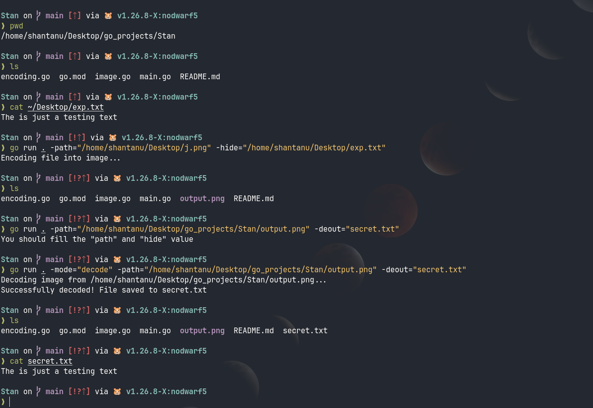

# Stan
### A Image Steganography Tool
Stan is a tool that hides files in png images. I replaces 2 LSB's.



## Features
- Hide files inside PNG image
- Checks if it fits or not
- Through CLI so 1 command is all it needs
- for windows and linux both 

## Insallation 

You can direcly download the binaries 

[Downlaod for Linux](https://github.com/shantanuparte/Stan/releases/download/v1.0.0/stan)

for Windows

[Download for Windows](https://github.com/shantanuparte/Stan/releases/download/v1.0.0/stan.exe)

## Build for yourself

Clone the repo ¯\(ツ)/¯
```
https://github.com/shantanuparte/Stan.git
```

build it
```
go build -o stan .
```

## Usage 
You can also use ```./stan --help```

Stan has 2 modes: encode and decode 


1.Encode: Hide the file inside the image

```./stan -mode=encode -path="home/user/Desktop/image.png"-hide="home/user/Desktop/secret.txt" -output="encoded.png"```

mode is optional here as it's default value is encode
- path: Path to original png image
- hide: Path to file to hide
- output: The output image containing the hidden file

2.Decode: To extract the file from the image

```
./stan -mode=decode -path="encoded.png" -deout="recovered.txt"
```

- path: path of image to decode 
- deout: file type/name

Make sure you use the exact output filename for the extracted file

## License
I'm using MIT so feel free to use
